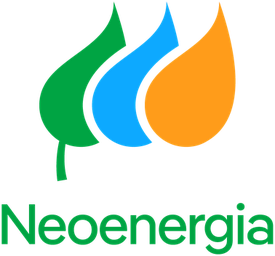

<p align="center">
  
</p>

# Neoenergia Cosern — Fatura por e-mail (Home Assistant)

[](https://github.com/hudsonbrendon/ha-neoenergia-fatura/actions/workflows/tests.yml)
[](https://github.com/hudsonbrendon/ha-neoenergia-fatura/actions/workflows/hassfest.yml)
[](https://github.com/hudsonbrendon/ha-neoenergia-fatura/actions/workflows/validate.yml)
[](https://github.com/hudsonbrendon/ha-neoenergia-fatura/releases)
[](https://github.com/hudsonbrendon/ha-neoenergia-fatura/releases)
[](https://hacs.xyz/)
[](https://www.home-assistant.io/)
[](LICENSE)

Integração não-oficial que traz para o Home Assistant os dados de energia da
**Neoenergia Cosern** lendo os **e-mails de fatura digital** e o **demonstrativo
de geração distribuída** (energia solar) que a Cosern envia — sem depender da API
da agência virtual (que é protegida por reCAPTCHA).

> Projeto pessoal, sem vínculo com a Neoenergia. Use com a sua própria conta.

## Por que por e-mail?

A agência virtual exige reCAPTCHA v3 no login, então não dá para uma integração
headless falar com a API. Mas a Cosern manda todo mês dois e-mails (de
`@faturaneoenergiacosern.com.br`) com a fatura e o demonstrativo solar em PDF.
Esta integração lê esses e-mails por IMAP e extrai os números dos PDFs.

## Pré-requisitos

1. **Fatura digital ativa** na agência virtual (entrega por e-mail).
2. O e-mail que recebe as faturas acessível por **IMAP**. No Gmail:
   - Ative a verificação em 2 etapas e crie uma **senha de app**
     (myaccount.google.com → Segurança → Senhas de app).
3. A **senha dos PDFs** = os **5 primeiros dígitos do CPF/CNPJ** do titular.

## Instalação (HACS)

[](https://my.home-assistant.io/redirect/hacs_repository/?owner=hudsonbrendon&repository=ha-neoenergia-fatura&category=integration)
[](https://my.home-assistant.io/redirect/config_flow_start/?domain=neoenergia_fatura)

1. HACS → repositórios customizados → `hudsonbrendon/ha-neoenergia-fatura`
   (Integration).
2. Instale e reinicie o Home Assistant.
3. Adicionar Integração → **Neoenergia Cosern (Fatura por e-mail)** → informe
   o e-mail, a senha de app, a senha do PDF (5 dígitos do CPF) e o servidor IMAP
   (`imap.gmail.com` já vem preenchido).

## Entidades

Da **fatura**: valor, vencimento, consumo (kWh, com histórico de 13 meses nos
atributos), energia injetada, saldo de créditos, bandeira tarifária, linha
digitável (atributo).

Da **geração distribuída (solar)**: potência da usina, saldo acumulado de
créditos, energia injetada no mês, energia compensada no mês, total injetado.

Atualização a cada 12 h.

## Desenvolvimento

```bash
python3 -I tests/test_parser.py   # valida o parser contra os PDFs reais
```

## Aviso

O layout do PDF pode mudar e quebrar o parser. Os PDFs vêm protegidos por senha;
a integração guarda a senha só para abri-los localmente. Nenhum dado sai do seu
Home Assistant.
